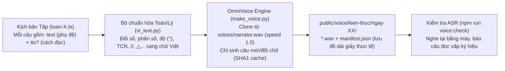

# Kế hoạch Kiến trúc & Flow Sản xuất Dự án: Thiên Đường Kiến Thức (`projects/kien-thuc`)

> **Mục tiêu:** Xây dựng dây chuyền sản xuất tự động (Voice AI + Hoạt họa Hình học & Stickman trên Remotion) cho kênh **Thiên Đường Kiến Thức**, chuyên sản xuất video khung dọc **`1080×1920` (9:16)** đăng **YouTube Shorts & TikTok** theo phong cách Giấy cổ (Parchment) + Stickman + Trực quan hóa Toán/Lý/Kỹ thuật.

---

## 1. Thông số Kỹ thuật & Định vị Dự án

| Hạng mục | Cấu hình chốt |
| :--- | :--- |
| **Tên kênh / Series** | **Thiên Đường Kiến Thức** |
| **Mã dự án (`id` / `short`)** | `kien-thuc` / `kt` (nằm tại `D:\Video\projects\kien-thuc`) |
| **Khung hình & Tốc độ khung** | **Dọc `1080×1920` (Full HD 9:16), `30 FPS`** — Chuẩn **YouTube Shorts & TikTok** (đồng bộ `WIDTH = 1080, HEIGHT = 1920` với toàn bộ `engine/` hiện có) |
| **Thời lượng mục tiêu** | **60 – 175 giây / tập** (`1 – dưới 3 phút`, khoảng `220 – 450 chữ`):<br/>• **Dưới 180 giây (3 phút):** Đủ điều kiện đăng làm **YouTube Shorts** (chuẩn Shorts tối đa 3 phút).<br/>• **Trên 60 giây (1 phút):** Đủ điều kiện video dài trên **TikTok**. |
| **Phong cách hình ảnh** | **Phương án A (Parchment Stage dọc 9:16 + Stickman + 2.5D Geometry)**: Nền giấy da cổ, HUD thương hiệu `THIÊN ĐƯỜNG KIẾN THỨC` đặt trong vùng an toàn (`SAFE`), nhân vật Stickman dẫn chuyện + hình học vector động xếp tầng dọc |
| **Giọng đọc** | **1 giọng kể duy nhất (`NARRATOR`)**: Giọng nam trưởng thành, trầm ấm, điềm tĩnh, sinh tự động bằng **OmniVoice** (`D:\Tao_giong_noi_local`) |

---

## 2. Bố cục Khung dọc `1080×1920` & Vùng An Toàn (`Safe Zones` cho Shorts/TikTok)

Trên giao diện dọc của TikTok và YouTube Shorts, cột phải (`x > 910`) bị nút Tim/Bình luận/Chia sẻ che, và đáy màn hình (`y > 1480`) bị tên kênh + caption che. Vì vậy khung `1080×1920` được chia thành **4 tầng dọc tối ưu cho biểu diễn hình học**:

```
+---------------------------------------------------+ y = 0
| [Vùng trống tránh thanh trạng thái điện thoại]    |
+---------------------------------------------------+ y = 140
| ⏱ Đồng hồ cổ        🏮 THIÊN ĐƯỜNG KIẾN THỨC     | <- Tầng 1: HUD Đầu trang & Tiêu đề nhịp (y: 140..300)
|       [ BÀI TOÁN / TIÊU ĐỀ NHỊP HIỆN TẠI ]        |
+---------------------------------------------------+ y = 300
|                                                   |
|          SÂN KHẤU CHÍNH & HÌNH HỌC ĐỘNG           | <- Tầng 2A: Mặt cắt đứng / Công trình / Vũ trụ
|     (Kim tự tháp, Tia nắng, Tam giác ABC,         |    (y: 300..820, Đường mặt đất tại y = 780)
|      Stickman dẫn chuyện, Mở trang SGK)           |
| ------------------------------------------------- | y = 780 (Mặt đất cố định)
|                                                   |
|     KHUNG CHIẾU MẶT BẰNG / BẢNG CÔNG THỨC         | <- Tầng 2B: Hạ mặt bằng đáy 2D / Hộp công thức Toán
|    (Hình vuông đáy 230m, Công thức AD/AB=DE/BC)   |    (y: 800..1180, căn lệch trái x: 70..910)
|                                                   |
+---------------------------------------------------+ y = 1200
|         [ PHỤ ĐỀ 1–2 DÒNG NỔI BẬT ]               | <- Tầng 3: Phụ đề (y: 1220..1360)
+---------------------------------------------------+ y = 1380
| 📚 EVIDENTIA (Thực nghiệm)    ⏳ THEORIA (Lý thuyết)| <- Tầng 4: Đế HUD cổ điển (y: 1380..1480)
+---------------------------------------------------+ y = 1480 (Giới hạn SAFE.bottom)
| [Vùng nhường cho Caption & Thanh nhạc TikTok/YT]  |
+---------------------------------------------------+ y = 1920
```

> **Lợi thế cực lớn của khung dọc `1080×1920` khi vẽ Toán – Lý:**
> Ở video ngang mẫu, không gian chiều dọc bị hẹp nên khi hạ mặt phẳng đáy hình vuông dưới chân kim tự tháp rất chật. Với khung dọc `1080×1920`, **Tầng 2A (Mặt cắt đứng)** và **Tầng 2B (Mặt bằng chiếu phẳng / Bảng công thức)** nằm thẳng hàng từ trên xuống dưới, người xem trên điện thoại nhìn đường gióng đứt nét rơi từ đỉnh kim tự tháp xuống tâm hình vuông đáy cực kỳ rõ ràng!

---

## 3. Flow Sinh Giọng Đọc Tự Động (Voice Generation Pipeline)

### 3.1. Sơ đồ luồng xử lý tiếng (`npm run voice -- -p kt <tập>`)



### 3.2. Các nâng cấp cụ thể trong `tools/voice/`
1. **Tạo giọng mẫu `voices/narrator.wav`:**
   - Bổ sung cấu hình `narrator` vào `tools/voice/design_voices.py` (`instruct: "male, mature, warm, calm storyteller, low pitch"`).
   - Đăng ký `"NARRATOR": {"ref": ROOT / "voices" / "narrator.wav", "speed": 1.0}` trong `SPEAKERS` của `tools/voice/make_voice.py`.
2. **Tách `text` (hiển thị phụ đề) và `tts` (đọc AI) cho công thức Toán – Lý:**
   - Thêm trường tùy chọn `tts?: string` vào `Line` trong `engine/lib/types.ts`.
   - Ví dụ:
     - `text`: `"Theo định lý Thales: AD/AB = AE/AC = DE/BC"` (hiển thị gọn trên phụ đề).
     - `tts`: `"Theo định lý Tha-lét: A D phần A B, bằng A E phần A C, bằng D E phần B C"` (đưa vào OmniVoice để đọc chính xác 100%).
3. **Mở rộng từ điển Toán – Lý – Lịch sử trong `tools/voice/vi_text.py`:**
   - Ký hiệu lịch sử & đơn vị: `TCN` → `"trước công nguyên"`, `SCN` → `"sau công nguyên"`, `m³` → `"mét khối"`, `km²` → `"ki lô mét vuông"`, `°` → `"độ"`.
   - Ký hiệu hình học: `△` → `"tam giác"`, `//` → `"song song với"`, `⊥` → `"vuông góc với"`, `≈` → `"xấp xỉ bằng"`.
4. **Cấu hình giới hạn thời lượng Shorts/TikTok trong `tools/voice/voice.mjs`:**
   - Cho phép từng dự án khai báo `maxSeconds` trong `project.json` (với `kien-thuc` đặt `maxSeconds: 175` để đảm bảo luôn dưới ngưỡng 3 phút của YouTube Shorts).

---

## 4. Flow Dựng Video Tự Động Theo Tiếng Thật (`engine/parchment/`)

### 4.1. Kiến trúc Sân khấu Giấy cổ `1080×1920` (`engine/parchment/`)

```
engine/parchment/
  ParchmentPlayer.tsx     Bộ phát 1080×1920: đồng bộ Audio + ParchmentStage + HUD + Phụ đề + SFX + LoopBack
  ParchmentHud.tsx        Khung giấy cổ 9:16 + 4 góc cố định trong vùng an toàn (Đồng hồ, Đèn bão "THIÊN ĐƯỜNG KIẾN THỨC", Kệ sách EVIDENTIA, Đồng hồ cát THEORIA)
  Stickman.tsx            Nhân vật Stickman đen viền trắng kem + trang phục theo thời đại (Ai Cập, Hy Lạp, Kiểm lâm, Kỹ sư) + đạo cụ (cọc, thước chữ L, dây thừng)
  primitives.tsx          Bộ công cụ vẽ Hình học 2D/2.5D động theo stepFrame (khung 1080×1920):
                            - GeoLine / ParallelRays (tia nắng, đường cao, đường ngắm đứt nét tự vẽ từ A → B)
                            - GeoAngle (ký hiệu góc vuông 90°, cung góc 45° kèm số đo)
                            - SegmentGlow (làm sáng cạnh tam giác khớp đúng lúc giọng đọc gọi tên)
                            - OrthoUnfold (chiếu mặt bằng đáy ở Tầng 2B ngay dưới mặt cắt đứng Tầng 2A)
                            - FormulaPanel (bảng công thức phân số bay chữ từ hình vẽ xuống)
                            - TextbookMorph (thu nhỏ cảnh vào trang SGK Toán/Lý rồi phóng to thành hình học)
                            - SplitUniverse (chia đôi màn hình trên/dưới đối chiếu Mặt đất ↔ Vũ trụ)
```

### 4.2. Khuôn 6 Hồi chuẩn cho mọi tập (`projects/kien-thuc/src/episodes/make.ts`)

| Mã nhịp (`BeatKind`) | Vai trò trong tuyến nội dung | Hiệu ứng hình ảnh chủ đạo (trên khung dọc `1080×1920`) |
| :--- | :--- | :--- |
| `1. hook` | **Bối cảnh lịch sử & Bài toán lớn** | Toàn cảnh công trình (2.5D rotation), Stickman xuất hiện đặt câu hỏi chiều cao/khoảng cách $H = ?$ |
| `2. barrier` | **Đập bỏ các cách làm thông thường** | Minh họa Cách 1 (thả dây bị lệch trung đoạn) & Cách 2 (vướng lõi đá đặc X-quang) kèm dấu `✖` đỏ |
| `3. eureka` | **Khoảnh khắc Eureka & Giải bằng trực giác** | Tia sáng Mặt Trời song song, cắm cọc chờ góc $45^\circ$, hạ mặt bằng đáy xuống Tầng 2B tính kết quả |
| `4. theorem` | **Kết nối SGK & Khái quát hóa Định lý** | Chuyển cảnh mở trang SGK ở giữa màn hình, dịch chuyển đoạn thẳng trên $\triangle ABC$, hiện công thức ở Tầng 2B |
| `5. realworld` | **Biến thể thực chiến đời sống** | Đổi bối cảnh (công trường / rừng rậm / biển khơi), ứng dụng công cụ tự chế (thước chữ L, dây 12 nút...) |
| `6. cosmic` | **Cao trào Vũ trụ & Triết lý kết bài** | Zoom-out xuyên tầng mây lên Vũ trụ (Nhật thực / Hành tinh / Siêu công trình) + Chia đôi Trên/Dưới kết bài |

---

## 5. Quy trình Vận hành cho mỗi Video mới (Đồng bộ 100% với CLI & Bot Telegram hiện tại)

Vì dùng chung kích thước `1080×1920` với 3 dự án sẵn có trong `D:\Video`, toàn bộ công cụ xuất video, ảnh bìa, phụ đề `.srt` và **Telegram Bot** đều chạy trực tiếp không cần sửa đổi lệnh:
1. **Nhập kịch bản vào `projects/kien-thuc/src/episodes/tuan-X.ts`**.
2. **Sinh giọng đọc & Kiểm tra ASR:**
   ```bash
   npm run voice -- -p kt 1
   npm run voice:check -- -p kt 1
   ```
3. **Xem trước hoặc Xuất MP4 (`1080×1920`) + Cover + SRT:**
   ```bash
   npm run dev                 # Xem trực tiếp trong Remotion Studio (Folder: KienThuc)
   npm run render -- -p kt 1   # Xuất out/kien-thuc/video/ngay-01.mp4 (1080x1920) + cover + gói đăng bài
   ```
